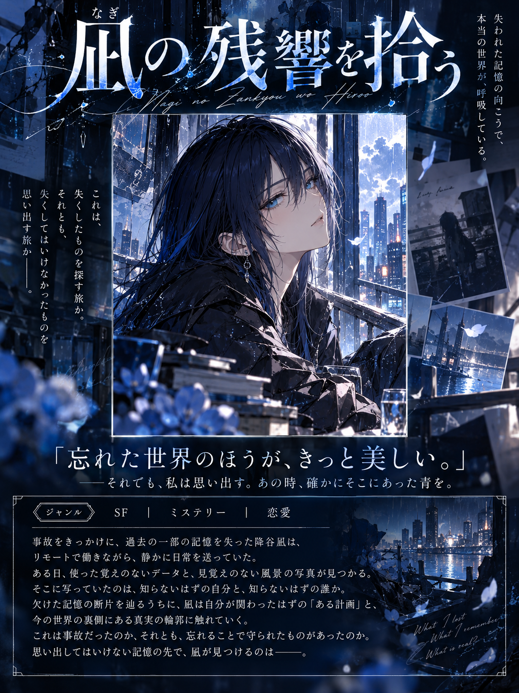

# あなたが主人公の小説を作るプロンプト

名前・性別・好きな色・主人公の参考画像から、AIが架空の小説を構想し、**タイトル・表紙・ジャンル・キャッチコピー・あらすじ**を1枚の書籍紹介ポスターにまとめる画像生成プロンプトです。

## 生成サンプル

> あなたの名前から、どんな物語が生まれるでしょうか。

## 使い方

1. [PROMPT.md](PROMPT.md) を開き、全文をコピーします。
2. ChatGPTなど、画像生成に対応したAIに貼り付けます。
3. 名前・性別・好きな色を入力し、主人公の容姿の参考画像を添付します。
4. 生成された架空の小説ポスターをお楽しみください。

## 生成されるもの

- 小説のタイトル
- 参考画像をもとにした表紙イラスト
- ジャンル
- 約30文字のキャッチコピー
- 約150〜200文字のあらすじ

画像は縦長（横3：縦4）を想定しています。実際のレイアウトや日本語の精度は、使用するAIによって異なります。

## 入力例

- 名前：降谷凪
- 性別：女
- 好きな色：青
- 主人公の容姿：使用許可のある参考画像を添付

<!-- サンプル画像を追加したら、次の行のコメントを外してください。

-->

## このプロンプトの特徴

名前の漢字の意味、字面、音の響きを比喩・象徴・逆説も含めて解釈し、AIがジャンルや物語を考えます。性格や趣味などの情報はあえて必須にせず、少ない情報から生まれる意外性も楽しめる設計です。

## 利用条件

**プロンプトの利用・改変は自由です。生成画像の公開に制作者クレジットは必要ありません。**

ただし、**プロンプトの全文または改変版を再配布する場合は、制作者「降谷凪」のクレジット表記をお願いします。** 詳しくは [TERMS.md](TERMS.md) をご覧ください。

クレジット表記例：

> 原案・プロンプト制作：降谷凪

## 注意事項

- 画像生成AIは日本語の誤字やレイアウトの崩れを起こすことがあります。
- 生成結果は実行するたびに異なり、既存作品との類似やタイトルの重複を完全には排除できません。
- 参考画像には、ご自身が利用できる画像または許諾を得た画像を使用してください。
- 生成画像の公開・商用利用には、使用するAIサービスの規約や第三者の権利が別途関係します。

## 制作

企画・制作：**降谷凪**  
ChatGPTとの対話を通じてプロンプトを改良しました。

- X：https://x.com/nagi_furuya
